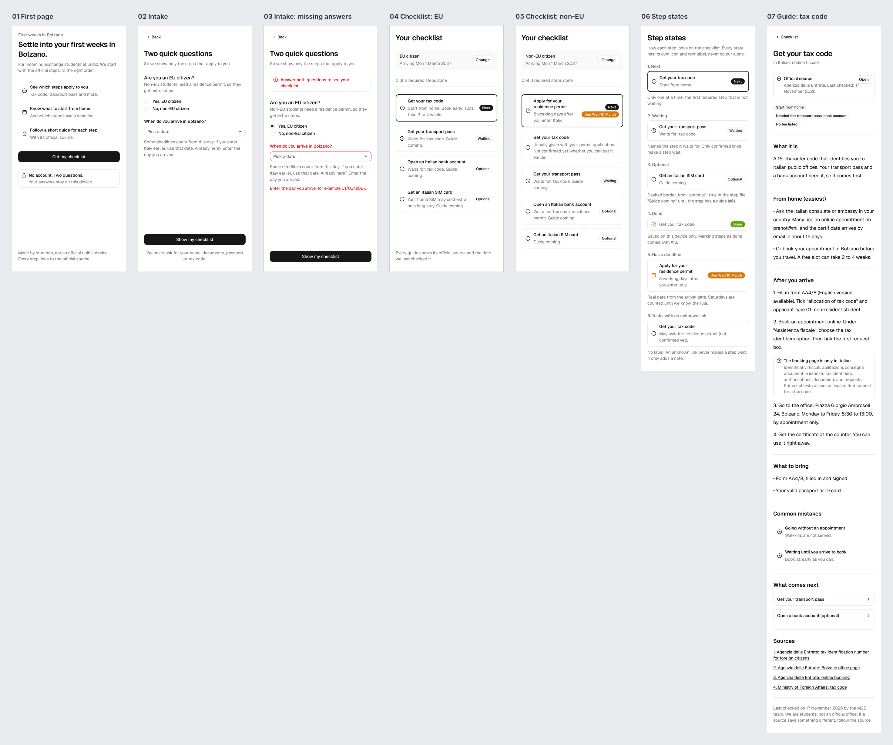
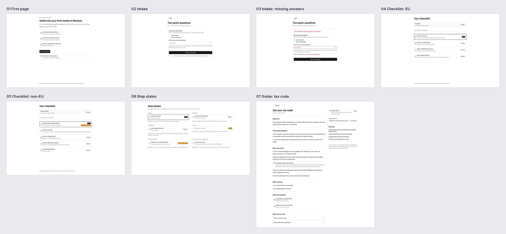

# Design

**Source of truth:** the Figma file [M2B screens](https://www.figma.com/design/4kKphPuniMJTSjhTzqHr6O). The PNGs here are exported snapshots.

## Phone

## Desktop

## Screens

| Screen                         | Phone                                                            | Desktop                                                            |
| ------------------------------ | ---------------------------------------------------------------- | ------------------------------------------------------------------ |
| 01 First page                  | [mobile/01-first-page.png](mobile/01-first-page.png)             | [desktop/01-first-page.png](desktop/01-first-page.png)             |
| 02 Intake                      | [mobile/02-intake.png](mobile/02-intake.png)                     | [desktop/02-intake.png](desktop/02-intake.png)                     |
| 03 Intake with missing answers | [mobile/03-intake-errors.png](mobile/03-intake-errors.png)       | [desktop/03-intake-errors.png](desktop/03-intake-errors.png)       |
| 04 Checklist, EU student       | [mobile/04-checklist-eu.png](mobile/04-checklist-eu.png)         | [desktop/04-checklist-eu.png](desktop/04-checklist-eu.png)         |
| 05 Checklist, non-EU student   | [mobile/05-checklist-non-eu.png](mobile/05-checklist-non-eu.png) | [desktop/05-checklist-non-eu.png](desktop/05-checklist-non-eu.png) |
| 06 Step states                 | [mobile/06-step-states.png](mobile/06-step-states.png)           | [desktop/06-step-states.png](desktop/06-step-states.png)           |
| 07 Tax code guide              | [mobile/07-guide-tax-code.png](mobile/07-guide-tax-code.png)     | [desktop/07-guide-tax-code.png](desktop/07-guide-tax-code.png)     |

## Design system

- **Kit:** [spartan/ui for Figma](https://www.figma.com/community/file/1691576794328156128/spartan-ui-for-figma-a-1-1-design-kit-of-spartan-ng), a 1:1 kit of the spartan/ui Angular components. Every screen is built from its components (Button, Item, Badge, Alert, Field Set, Field, Radio Group, Date Picker, Progress, Card, Separator), text styles and variables, so Figma's Dev Mode shows the matching Angular code.
- **Theme:** neutral main colour (Accent "Default"), Style "Nova", light mode. The colour palette is decided later; changing it is one variable mode.
- **Status colours:** a deadline uses the kit's Amber palette and "Done" its Green palette, only on those badges and icons. In code this needs a small CSS class that switches the accent variables.
- **Font:** Geist, the kit's font. The app currently uses the system font.
- **Desktop layout:** one centred column of 640 px; the intake form sits in a card of 560 px; the step states are a two-column grid; the guide moves the official source, facts and sources into a side column. Tablet widths use the same centred column.
